# Geolocation Risk Monitor

**Disruption intelligence for operations teams.**

> Signals are situational awareness derived from public news and public data feeds. They are not official warnings. Verify with
> local authorities and follow their guidance.

## Table of contents

1. [Overview](#overview)
2. [Objectives](#objectives)
3. [What we build](#what-we-build)
4. [How it helps](#how-it-helps)
5. [Architecture](#architecture)
6. [Repository layout](#repository-layout)
7. [Quick start: the demonstration](#quick-start-the-demonstration)
8. [Development](#development)
9. [Quality and verification](#quality-and-verification)
10. [Security and privacy](#security-and-privacy)
11. [Documentation](#documentation)
12. [Status and known limits](#status-and-known-limits)

## Overview

**Geolocation Risk Monitor** is a disruption intelligence platform for operations, security, and supply chain teams. It turns
public news and public hazard data into a clear, evidence backed view of which incidents are happening, where, and which of an
organization's sites and routes they may affect.

### The problem

Disruptions such as earthquakes, floods, storms, fires, strikes, and civil unrest are reported first in scattered places: hazard
agency bulletins, local news, and word of mouth. Teams read these sources by hand, and the hardest step is not finding the story
but answering two questions reliably: **where exactly did this happen**, and **does it matter to us**. Place names are ambiguous
(many towns share a name), articles are noisy, and a wrong location produces either a missed risk or a false alarm.

### The approach

The platform works as a pipeline with four stages:

1. **Collect.** Scheduled harvesters read public hazard feeds and news, and track the health of every source.
2. **Locate.** BELA based entity linking resolves each mention to a place in a unified gazetteer built from GeoNames and
   Wikidata, with a context re-ranker and optional local language model adjudication. Every place carries an uncertainty radius.
3. **Assess.** Each incident is scored against a customer's confidential asset locations and routes by severity, distance, and
   location confidence.
4. **Act.** Alerts enter a queue where people acknowledge, assign, and report on them, and signed webhooks deliver them to other
   systems.

### Design commitments

- **Evidence with every decision.** The application shows which place it chose, which candidates it rejected, how confident it is,
  and which text supports the choice. Analysts can correct a wrong location.
- **People decide.** A language model never raises an alert on its own.
- **Graceful degradation.** If a model or service is unavailable, the platform falls back to defined rules, lowers and flags
  confidence, and never drops work silently.
- **Isolated tenants.** Each customer's data is separated in the database itself, and asset locations are treated as confidential.
- **Untrusted text.** Article and report content is handled as data and is never followed as instructions.

## Objectives

| # | Objective | How it is met |
|---|---|---|
| 1 | Find the right place for each incident | Entity linking with a place knowledge base that carries uncertainty radii and a hierarchy |
| 2 | Quantify exposure per customer | Spatial search over each tenant's confidential asset locations, scored by severity, distance, and confidence |
| 3 | Make decisions explainable | Candidates, scores, and source text are stored and displayed with every incident |
| 4 | Keep working when parts fail | Defined degraded modes, a dead letter queue, and visible source health |
| 5 | Protect each customer's data | Row Level Security, role based access, MFA, signed sessions, audit chain |
| 6 | Be reproducible by a reviewer | One command builds a seeded environment from a clean clone |

## What we build

- **Ingestion.** Scheduled harvesters for public hazard feeds and news, with per source health tracking and retry.
- **A place knowledge base.** GeoNames and Wikidata merged into one gazetteer with names, aliases, hierarchy, and uncertainty radii.
- **Entity linking.** A BELA based linking service, a context re-ranker, and optional local language model adjudication, with
  rule based fallbacks.
- **An incident model.** Events with type, severity, location, evidence, lifecycle, and corrections.
- **Exposure and alerting.** Per tenant exposure scoring against assets and routes, alert rules, a queue with acknowledge and
  assign, webhooks with signed delivery and retry, and a delivery log.
- **A product application.** Map, incidents, alerts, assets, analytics, briefings, reports (PDF and map images), administration,
  and a revenue view.
- **A marketing site and API.** Public pages, a documented REST API with API keys, and an OpenAPI reference.
- **Operations tooling.** Backup and restore drill, load and security test tooling, and a production style container stack.

## How it helps

| For | Benefit |
|---|---|
| Operations leads | See what is happening near sites and routes as it is reported, ranked by exposure rather than by volume |
| Analysts | Check any location decision against its candidates and source text, and correct it when it is wrong |
| Managers | Track acknowledgement, assignment, and response in one queue, with reports for review meetings |
| Security and compliance | Isolated tenant data, audit trail, no secrets in logs, documented controls and open items |
| Platform teams | Predictable degraded behavior, health visibility, and a runbook for the failures that were planned for |

## Architecture

The diagram shows the end to end workflow: public sources enter through harvesters, the processing pipeline resolves places and
builds incidents, the exposure engine scores them against tenant assets, and the alert layer delivers results to people and
systems. See the note below the diagram for how to read it.

```mermaid
%%{init: {"theme": "base", "flowchart": {"curve": "basis", "nodeSpacing": 40, "rankSpacing": 70}, "themeVariables": {"fontFamily": "Inter, Segoe UI, Helvetica, Arial, sans-serif", "fontSize": "14px", "lineColor": "#546E7A"}}}%%
flowchart LR
    subgraph SRC["<b>① PUBLIC SOURCES</b>"]
        direction TB
        S1["<b>Hazard feeds</b><br/><i>earthquake, weather,<br/>disaster bulletins</i>"]
        S2["<b>News feeds</b><br/><i>headlines and articles</i>"]
    end

    subgraph ING["<b>② INGESTION</b>"]
        direction TB
        H["<b>Harvest scheduler</b><br/><i>retry, backoff,<br/>per source health</i>"]
        DLQ[("<b>Dead letter queue</b><br/><i>identifiers only,<br/>timed retries</i>")]
    end

    subgraph INT["<b>③ LOCATION INTELLIGENCE</b>"]
        direction TB
        CL["<b>Headline classifier</b><br/><i>type and severity</i>"]
        NEL["<b>Entity linker</b><br/><i>BELA service</i>"]
        RR["<b>Context re-ranker</b><br/><i>candidate scoring</i>"]
        LLM["<b>Language model</b><br/><i>optional adjudication</i>"]
        GZ[("<b>Place knowledge base</b><br/><i>GeoNames + Wikidata,<br/>uncertainty radii</i>")]
    end

    subgraph CORE["<b>④ RISK ENGINE</b>"]
        direction TB
        EV["<b>Incident builder</b><br/><i>evidence, lifecycle,<br/>corrections</i>"]
        EXP["<b>Exposure engine</b><br/><i>spatial search over<br/>tenant assets</i>"]
        ALR["<b>Alert engine</b><br/><i>rules, queue,<br/>acknowledge, assign</i>"]
        WRK["<b>Worker</b><br/><i>webhooks, retention,<br/>audit verification</i>"]
    end

    subgraph DATA["<b>⑤ DATA AND STATE</b>"]
        direction TB
        PG[("<b>PostgreSQL 17</b><br/><i>PostGIS, pgvector,<br/>Row Level Security</i>")]
        VK[("<b>Valkey</b><br/><i>rate limits, streams<br/>optional</i>")]
    end

    subgraph OUT["<b>⑥ ACCESS AND DELIVERY</b>"]
        direction TB
        API["<b>FastAPI service</b><br/><i>REST, auth, CSRF,<br/>MFA, API keys</i>"]
        CADDY{{"<b>Caddy</b><br/><i>TLS, reverse proxy</i>"}}
        WEB["<b>Web application</b><br/><i>map, incidents, alerts,<br/>assets, analytics</i>"]
        RPT["<b>Reports</b><br/><i>PDF and map images</i>"]
        WH["<b>Webhooks</b><br/><i>signed, retried</i>"]
        USR(["<b>Operations teams</b><br/><i>viewer, analyst,<br/>manager, admin</i>"])
    end

    S1 --> H
    S2 --> H
    H -->|"hazard records"| EV
    H -->|"news articles"| CL
    CL --> NEL --> RR --> EV
    GZ --> NEL
    GZ --> RR
    RR <-.->|"optional"| LLM
    NEL -.->|"fallback: gazetteer rules"| RR
    CL -.->|"unavailable"| DLQ
    DLQ -.->|"timed retry"| CL
    EV --> EXP --> ALR --> WRK
    CORE ==>|"persist"| PG
    PG ==>|"read"| API
    VK -.-> API
    API --> CADDY --> WEB --> USR
    API --> RPT --> USR
    WRK --> WH --> USR

    classDef source fill:#E3F2FD,stroke:#1565C0,stroke-width:2px,color:#0D2A4D
    classDef ingest fill:#FFF3E0,stroke:#EF6C00,stroke-width:2px,color:#4A2600
    classDef intel fill:#F3E5F5,stroke:#7B1FA2,stroke-width:2px,color:#2E0F3B
    classDef core fill:#E8F5E9,stroke:#2E7D32,stroke-width:2px,color:#0F3313
    classDef data fill:#ECEFF1,stroke:#37474F,stroke-width:2px,color:#1B262C
    classDef out fill:#FFEBEE,stroke:#C62828,stroke-width:2px,color:#4A0E0E
    classDef edge fill:#FFFDE7,stroke:#F9A825,stroke-width:2px,color:#4A3B00
    classDef user fill:#C62828,stroke:#7F0000,stroke-width:2px,color:#FFFFFF

    class S1,S2 source
    class H,DLQ ingest
    class CL,NEL,RR,LLM,GZ intel
    class EV,EXP,ALR,WRK core
    class PG,VK data
    class API,WEB,RPT,WH out
    class CADDY edge
    class USR user

    style SRC fill:#F5FAFF,stroke:#1565C0,stroke-dasharray: 4 3
    style ING fill:#FFFAF2,stroke:#EF6C00,stroke-dasharray: 4 3
    style INT fill:#FBF5FC,stroke:#7B1FA2,stroke-dasharray: 4 3
    style CORE fill:#F4FAF4,stroke:#2E7D32,stroke-dasharray: 4 3
    style DATA fill:#F7F9FA,stroke:#37474F,stroke-dasharray: 4 3
    style OUT fill:#FFF6F6,stroke:#C62828,stroke-dasharray: 4 3
```



**Reading the diagram.** Solid arrows are the normal flow. Dashed arrows are optional or degraded paths. Thick arrows are
database reads and writes. Hazard feed records carry coordinates and go straight to the incident builder; news articles pass
through classification and place linking first. If the classifier is unavailable, the article identifiers (never the text) wait
in the dead letter queue and are retried on a timer. If the linker is unavailable, places are found with gazetteer rules and
the incident is marked as reduced confidence.

### Design principles

- **Evidence first.** Each incident keeps its candidate places, scores, and source text.
- **Fail soft.** A missing model or linker lowers confidence and is flagged; work is never silently dropped.
- **Tenant isolation in the database.** Row Level Security is enforced by the database role, not only by application code.
- **Untrusted text.** Article and report text is treated as data and is never executed or trusted as instructions.
- **Humans decide.** A language model never raises an alert alone.

Full detail is in [docs/architecture.md](docs/architecture.md).

## Repository layout

| Area | Where | What it is |
|---|---|---|
| API and worker | `apps/api` | FastAPI service, PostgreSQL schema and migrations, event pipeline, exposure and alert logic |
| Web | `apps/web` | Next.js marketing site and the product application |
| Place knowledge base | `apps/api` (ETL module) | GeoNames and Wikidata merged into one gazetteer with uncertainty radii |
| Entity linking | `services/nel`, `apps/api` (linking module) | BELA service, context re-ranker, optional local language model adjudication |
| Data | `data` | Acquisition scripts, manifest with checksums, gold sets, replay seed, licensing register |
| Operations | `infra` | PostgreSQL image, container stack, load and security tooling, backup drill |
| Documents | `docs` | Architecture, API guide, data guide, model card, evaluation, runbook, security, performance |

## Quick start: the demonstration

**Requirements:** Python 3.11 or newer, Node.js 20 or newer, curl, and PostgreSQL 17 with PostGIS and pgvector
(`brew install postgresql@17 postgis pgvector` on macOS; set `PGBIN` if the binaries are elsewhere).

```bash
git clone https://github.com/codearchitect14/geolocation-risk-monitor-with-BELA.git
cd geolocation-risk-monitor-with-BELA
make demo
```

`make demo` installs the dependencies, downloads the small data files (GeoNames cities and Natural Earth boundaries, checksum
verified), creates a local PostgreSQL cluster, builds a small place knowledge base, loads a recorded earthquake feed as history,
creates a demonstration tenant with accounts and illustrative assets, and starts the API and the web application. Sign-in details
for six accounts are printed once at the end; only their hashes are stored. Open `http://127.0.0.1:3000/login`.

```bash
make replay        # play the recorded feed live: new incidents appear on the map and alerts are raised
make demo-down     # stop the servers (the data stays)
make demo-reset    # delete the demo database
```

The public demonstration uses the read-only viewer account (`demo-viewer@example.com`). Administrator and platform accounts ask
for an authenticator app at first sign-in. Everything shown is synthetic or illustrative: the sites, the portfolio, and the
revenue history. Incidents come from a recorded public earthquake feed that is re-timed for the demonstration.

**Not included in the demonstration:** the entity linking model (about 33 GB), the local language model, and the full place
knowledge base (Wikidata subset, embeddings). News articles are therefore not processed in the demonstration; see
[docs/data-guide.md](docs/data-guide.md) to build the full set.

## Development

```bash
make setup              # Python environment
make db-init db-start   # local PostgreSQL cluster (.local/pgdata)
make db-upgrade         # migrations
make api-up             # API on 127.0.0.1:8090
make web-dev            # web on localhost:3000
make check              # lint, types, tests, character check
make web-check          # web lint, types, format, unit tests
make web-e2e            # end-to-end tests (needs the API, the web server, and seeded test accounts)
```

## Quality and verification

| Suite | Scope |
|---|---|
| `pytest` | About 450 tests; each run creates a throwaway database |
| Playwright | 68 tests in Chromium, including accessibility checks; cross-browser run with `make web-cross` |
| Static checks | ruff, mypy, ESLint, TypeScript, Prettier |
| Security | Bandit, pip-audit, npm audit, gitleaks, Trivy, ZAP baseline (see [docs/security.md](docs/security.md)) |
| Performance | 50 concurrent users, p95 10 ms across requests on one development machine (see [docs/perf.md](docs/perf.md)) |

Style rules: professional neutral text, and no U+2014 character (`infra/ci/check_no_em_dash.py`).

## Security and privacy

- Tenant isolation with Row Level Security; separate application and platform database roles.
- EdDSA signed session cookies, CSRF protection, MFA, Argon2id password hashes, and scoped API keys.
- Tenant asset locations are confidential and never appear in logs or in shared outputs.
- Hash chained audit log with scheduled verification.
- Demonstration passwords are generated, printed once, and stored only as hashes.

Controls, test evidence, and open items are in [docs/security.md](docs/security.md).

## Documentation

| Document | Content |
|---|---|
| [docs/architecture.md](docs/architecture.md) | Components, data flow, tenancy and security boundaries |
| [docs/api-guide.md](docs/api-guide.md) | Authentication, endpoints, samples in curl, Python, and JavaScript; `docs/openapi.json` is the reference |
| [docs/data-guide.md](docs/data-guide.md) | Sources, acquisition, the place knowledge base, rebuild steps |
| [docs/model_card.md](docs/model_card.md) and [docs/eval/report.md](docs/eval/report.md) | What the linking engine does, how it was evaluated, where it is weak |
| [docs/runbook.md](docs/runbook.md) | Operations, degraded modes, backup and restore |
| [docs/security.md](docs/security.md) | Controls, test evidence, scan results, open items |
| [docs/perf.md](docs/perf.md) and [docs/db_tuning.md](docs/db_tuning.md) | Load results and database tuning |
| [docs/deploy.md](docs/deploy.md) | Production style container stack |
| [docs/licensing.md](docs/licensing.md) | Data and software licenses |
| [docs/walkthrough.md](docs/walkthrough.md) | Scripted product tour |
| [docs/adr](docs/adr) | Architecture decision records |

## Status and known limits

Built in phases against `PLAN_disruption_intelligence.md`. Open items are listed in the last section of each document, in
particular:

- the container stack has not been built or run on the development machine;
- the repository has no license file yet, and one dependency (Unidecode) is GPL licensed, which must be resolved before
  distribution (see [docs/licensing.md](docs/licensing.md));
- the content security policy still allows `unsafe-inline` ([docs/security.md](docs/security.md));
- browser frame rate with 5,000 map markers is not measured ([docs/perf.md](docs/perf.md)).
